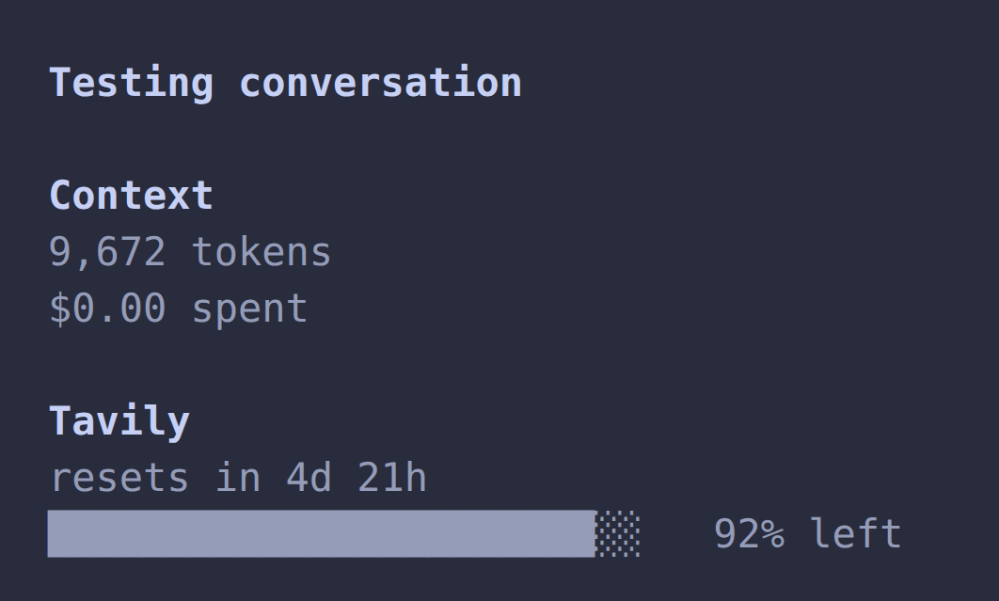

# opencode-tavily-quota

See how many Tavily API credits you have left without leaving OpenCode.



The plugin adds a **Tavily** section to the session sidebar with:

- a progress bar and the percentage of credits remaining,
- a countdown to the monthly reset,
- a one-command refresh.

It works with the Tavily account already connected to OpenCode, so in most cases
you do not need to paste a key.

## Requirements

- OpenCode 2.x
- A Tavily account and API key

## Install

```sh
opencode plugin add opencode-tavily-quota
```

Restart or reload OpenCode after installing. If you previously copied the plugin
into `~/.config/opencode/plugins/opencode-tavily-quota/`, remove that copy so it
is not loaded twice.

`opencode plugin add` is the recommended install: it registers both halves of the
plugin and can use OpenCode's Tavily connection. If you list the package in
`cli.json` instead, only the sidebar half runs. That is fine when you supply a
local key, but the OpenCode connection is not available in that setup.

## Connect Tavily

The easiest way is to connect Tavily to OpenCode:

```sh
opencode auth login tavily
```

You can also use `/connect` inside OpenCode. The active connection is read by the
OpenCode server, and the saved key is never displayed or sent to the terminal.

If you prefer a key just for this plugin, use either:

1. `TAVILY_API_KEY` in the environment that starts OpenCode, or
2. the `apiKey` plugin option (see [Configuration](#configuration)).

`TAVILY_API_KEY` wins over `apiKey`. OpenCode's Tavily connection is used when
neither is set.

## Use

The sidebar refreshes every 10 minutes. To refresh immediately:

- run `/tavily-quota`, or
- press `Ctrl+P` and choose **Refresh Tavily quota**.

A toast then shows the credits left, the percentage remaining, and the reset
countdown.

Quota checks share a per-key cache and request lock across sessions, locations,
and terminals that use the same cache directory. Automatic reads reuse a
snapshot for five minutes. Manual refresh can bypass that freshness cache, but
never the 65-second minimum between requests or an active rate-limit cooldown.

## Configuration

Options go on the plugin entry in `cli.json` or `opencode.json`:

```json
{
  "plugins": [
    {
      "package": "opencode-tavily-quota",
      "options": {
        "apiKey": "{file:~/.secrets/tavily-api-key}"
      }
    }
  ]
}
```

| Option | Default | Description |
| --- | --- | --- |
| `apiKey` | unset | Tavily API key. `{file:...}` and `{env:...}` are expanded by the plugin, so the raw key can stay out of the file. |
| `refreshMs` | `600000` | How often to check for updates, in milliseconds. Cached reads do not send an HTTP request; keeping the default is recommended. |

`{file:PATH}` reads a file's trimmed contents; `~/` expands to your home
directory. `{env:NAME}` reads an environment variable. A missing or unreadable
file is reported in the sidebar instead of being used as the key.

## Troubleshooting

| What you see | What to do |
| --- | --- |
| `no active Tavily connection` | Run `opencode auth login tavily` or `/connect`, or set `TAVILY_API_KEY` / `apiKey`. |
| `API key rejected (401)` | Check the key, then reconnect Tavily or update `apiKey`. |
| `rate limited on /usage` | This limit applies to quota checks, not searches. The plugin respects `Retry-After` (or waits ten minutes if absent/invalid), including across launches and manual refreshes. |
| `quota cache unavailable` | Check that the cache directory is writable. The plugin will not bypass a failed cache/lock and send uncoordinated requests. |
| A file-reference error | Check that the `{file:...}` path exists and is readable. |
| No Tavily section | Refresh or restart OpenCode, and confirm the plugin is installed. |

If your terminal connects to a remote OpenCode server and you want to use that
server's Tavily connection, install the plugin on the server as well.

## Good to know

- Tavily resets credits on the first day of each month. The API does not report
  the exact reset time, so the countdown assumes `00:00 UTC` and may differ from
  your local reset by a few hours.
- Only quota numbers are sent back to the terminal; the API key stays with the
  code that talks to Tavily.
- Quota snapshots and cooldowns live under
  `${XDG_CACHE_HOME:-~/.cache}/opencode-tavily-quota`, indexed by a SHA-256 key
  fingerprint. Cache files contain no API key. Both local keys and the server's
  saved Tavily connection use this cache, with a lock preventing concurrent
  requests from separate processes.
- Separate machines or different cache directories do not share a throttle.
  Other applications using the same key can still exhaust Tavily's limit.

## Development

Source lives in `index.ts` (OpenCode server), `quota-client.ts` (shared cache and
request coordination), `usage.ts` (HTTP client and formatting), and `tui.tsx`
(sidebar and command). Run `npm install`, `npm test`, `npm run typecheck`, and
`npm run build`. Tests use temporary cache directories and mocked HTTP requests,
including the separate-process regression test; they need no Tavily credentials.

## License

MIT
